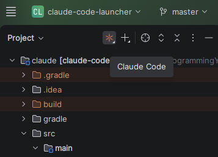
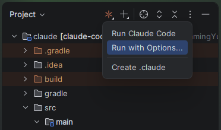
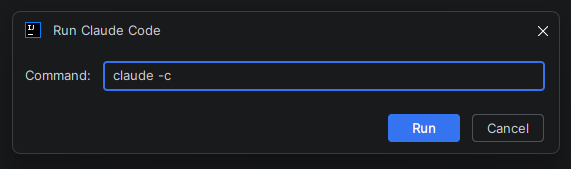

# Claude Code Launcher

A plugin for IntelliJ IDEA and Android Studio that adds a Claude Code button
to the Project view toolbar. It launches [Claude Code](https://claude.com/claude-code)
for the current project in a separate terminal window.



## Features

Clicking the button opens a dropdown:



- **Run Claude Code** runs plain `claude` in the project root.
- **Run with Options...** opens a dialog with an editable command line, such
  as `claude -c` or `claude --resume`. **Run** saves the command for this
  project and launches it. **Cancel** closes the dialog without saving.
- **Create .claude** creates a `.claude` folder in the project root.



The saved command is stored per project in `.idea/claudeCodeLauncher.xml`.
Cyrillic letters that look like Latin ones (for example, `с` typed instead of
`c` on a Russian keyboard layout) are replaced automatically, so `-с` still
works as `-c`.

## Requirements

- IntelliJ IDEA or Android Studio based on platform 2023.3 (build 233) or newer.
- The `claude` CLI installed and available on `PATH`.
- Terminal used for the launch:
  - Windows: `cmd.exe`, maximized.
  - macOS: Terminal.app, full screen. On the first launch macOS asks whether
    the IDE may control Terminal; allow it (you can change this later in
    **System Settings → Privacy & Security → Automation**). Full screen also
    needs the IDE to be allowed under **Accessibility**; without it the
    window opens at its normal size.
  - Linux: the first terminal found from this list, with the one matching
    your desktop (GNOME, KDE, Xfce) tried first: `gnome-terminal`, `konsole`,
    `xfce4-terminal`, `x-terminal-emulator`, `tilix`, `kitty`, `alacritty`,
    `xterm`. The window is maximized where the terminal supports it. The
    command runs in your `$SHELL` as an interactive shell, so `PATH` entries
    from `~/.bashrc` or `~/.zshrc` apply.

## Installation

The same zip works in both IntelliJ IDEA and Android Studio. The plugin is
built against IntelliJ IDEA Community, which is the platform Android Studio
runs on.

### Option 1: Install the prebuilt zip

1. Open the [Releases](https://github.com/machine7y/ClaudeCodeLauncher/releases)
   page and download `claude-code-launcher-<version>.zip` from the latest release.
   Don't unpack it.
2. In the IDE, open **Settings → Plugins** (on macOS, **Settings** is under the
   **IntelliJ IDEA** or **Android Studio** menu).
3. Click the gear icon at the top and choose **Install Plugin from Disk...**.
4. Select the downloaded zip and click **OK**.
5. Restart the IDE if it asks you to.

### Option 2: Build from source

You need JDK 17 or newer, with `JAVA_HOME` pointing to it, and Git.
You don't need to install Gradle: the wrapper in the repository downloads the
right version.

1. Clone the repository:

   ```sh
   git clone https://github.com/machine7y/ClaudeCodeLauncher.git
   cd ClaudeCodeLauncher
   ```

2. Build the plugin:

   ```sh
   ./gradlew buildPlugin        # macOS / Linux
   gradlew.bat buildPlugin      # Windows
   ```

   The first build downloads Gradle and the IntelliJ Platform SDK, which is
   several hundred MB, so it can take a few minutes. Later builds are fast.

3. The build writes the zip to
   `build/distributions/claude-code-launcher-<version>.zip`.
4. Install that zip as in steps 2–5 of [Option 1](#option-1-install-the-prebuilt-zip).

### Updating

To update, install a newer zip the same way. The IDE replaces the old
version.

To remove the plugin, open **Settings → Plugins → Installed**, select
**Claude Code Launcher** and choose **Uninstall**.

## License

Licensed under the [MIT License](LICENSE).
